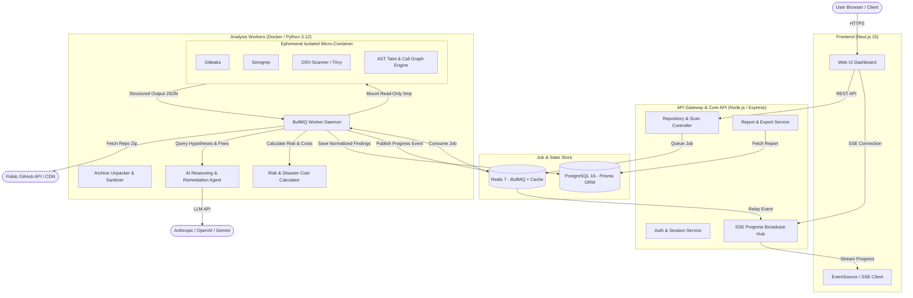

# 03. CyberShield — System Architecture & Deployment

## 1. System Components & Data Flow



---

## 2. Scan Pipeline Stages

```mermaid
sequenceDiagram
    autonumber
    actor User
    participant API as API Service
    participant Queue as BullMQ (Redis)
    participant Worker as Scan Worker
    participant Box as Sandbox Container
    participant AI as AI Engine
    participant DB as Postgres DB

    User->>API: POST /api/v1/scans (repoUrl)
    API->>API: 1. Validate URL & Rate Limits
    API->>Queue: Enqueue ScanJob(scanId, repoUrl)
    API-->>User: 202 Accepted {scanId}
    
    Queue->>Worker: Dequeue ScanJob
    Worker->>Worker: 2. Fetch Repo tarball/zip from GitHub
    Worker->>Worker: 3. Unpack & Sanitize (bomb checks, size caps, ignore binaries)
    Worker->>API: Emit Stage(VALIDATED, 15%)
    
    Worker->>Box: 4. Execute Analyzers (Gitleaks, Semgrep, Trivy, AST Taint)
    Box-->>Worker: Raw Tool Reports (SARIF / JSON)
    Worker->>API: Emit Stage(ANALYZED, 50%)
    
    Worker->>Worker: 5. Normalize Findings to Unified Schema
    Worker->>Worker: 6. Deduplicate & Correlate Cross-Tool Findings
    
    Worker->>AI: 7. AI Review (Verify Sinks, Novel Hypotheses, Remediation Patches)
    AI-->>Worker: Validated Findings + Code Diffs
    Worker->>API: Emit Stage(AI_REVIEWED, 80%)
    
    Worker->>Worker: 8. Calculate Risk Score (0-100) & Disaster Cost Model
    Worker->>DB: 9. Persist Scan, Findings, Dependencies, Scenarios
    Worker->>Worker: 10. Purge Local Temporary Source Files
    Worker->>API: Emit Stage(COMPLETED, 100%)
    API-->>User: SSE Event {status: "COMPLETED"}
```

---

## 3. Tech Stack Evaluation & Justification

| Architecture Option | Strengths | Weaknesses | Selected? |
| :--- | :--- | :--- | :--- |
| **Option A: Pure Monolithic Next.js (All-in-One API routes + Serverless Lambdas)** | Fast initial prototype, single language (TS), single deployment on Vercel. | Incompatible with security tools (cannot run Semgrep, Gitleaks, Docker containers inside standard serverless functions; execution timeouts limited to 60-300s; high CPU costs). | **NO** |
| **Option B: Decoupled Web (Next.js) + API (Node.js/Express) + Dedicated Containerized Workers (Python/Node + Docker)** | Rock-solid security isolation (untrusted code stays on worker containers); full access to native security CLI binaries; long-running job queues; horizontal scaling; predictable resource caps. | Slightly more initial setup (Docker Compose, Redis queue). | **YES (Chosen)** |

**Justification**: Security scanning inherently requires invoking command-line security binaries (Gitleaks, Semgrep, Trivy) and inspecting filesystem hierarchies. Option B guarantees complete host protection through disposable Docker environments, strict RAM/CPU caps, and persistent progress streaming over Redis Pub/Sub.

---

## 4. Sandboxing & Isolation Strategy

When processing untrusted GitHub repositories:
1. **Network Egress Blocked**: The container executing static analyzers runs with `--network none`. Analyzers cannot beacon out, download additional malware, or leak secrets.
2. **Read-Only Root Filesystem**: Worker mounts the unpacked source directory with `:ro` (read-only). Output files are written to a strictly limited in-memory `tmpfs` volume (max 128 MB).
3. **Resource & Capability Restrictions**:
   - `cap-drop=ALL` (drops all Linux capabilities)
   - `--security-opt=no-new-privileges`
   - Memory capped at `1024 MB`, CPU limit `1.5 cores`.
   - Execution hard timeout: `180 seconds` per analyzer container.
4. **Immediate Cleanup**: Once normalization completes, the temporary working folder is securely shredded and removed.

---

## 5. Streaming Progress & Caching Strategy

- **Real-Time Progress**: Using **Server-Sent Events (SSE)** via `/api/v1/scans/:id/stream`. Redis Pub/Sub broadcasts progress events:
  - `FETCHING` (0-20%)
  - `STATIC_ANALYSIS` (20-60%)
  - `NOVEL_DISCOVERY` (60-80%)
  - `SCORING_AND_REPORT` (80-100%)
- **Scan Caching**:
  - The repository's commit SHA is queried first via GitHub API.
  - If a scan for `(repoUrl, commitSha)` exists in Postgres from the last 24 hours, the existing report is served instantly (cache HIT), with an option for the user to force a re-scan.

---

## 6. Monthly Operational Cost Estimate (1,000 Scans/Month)

| Resource | Specification | Monthly Cost (USD) |
| :--- | :--- | :--- |
| **Frontend & API Hosting** | DigitalOcean App Platform / Render (2 GB RAM, 1 vCPU) | $15.00 |
| **Database & Queue** | Managed PostgreSQL (10 GB) + Managed Redis (1 GB) | $22.00 |
| **Worker Nodes (Scanners)**| 1 dedicated Hetzner / DigitalOcean Droplet (4 vCPU, 8 GB RAM) | $24.00 |
| **AI LLM API Tokens** | ~50k tokens per scan × 1,000 scans = 50M tokens (mixed Claude Haiku 3.5 / GPT-4o-mini / Gemini Flash) | $35.00 |
| **Object Storage (PDF exports)**| AWS S3 / Cloudflare R2 (50 GB) | $1.00 |
| **Total Estimated Cost** | **~1,000 scans/month** | **~$97.00/mo ($0.097 / scan)** |
