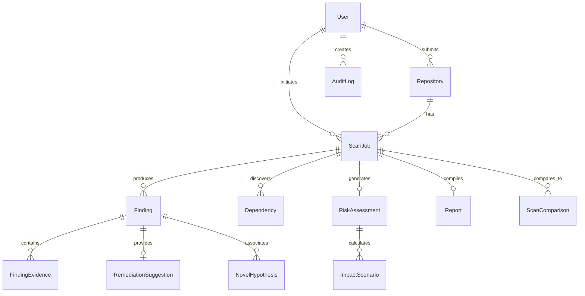

# 04. CyberShield — Data Model & Storage Strategy

## 1. Entity-Relationship Diagram (ERD)

---

## 2. Relational Database Schemas (Prisma Definition Overview)

### User & Authentication
- **User**: `id (UUID)`, `email (String, Unique)`, `passwordHash (String)`, `fullName (String)`, `role (ENUM: USER, ADMIN, AUDITOR)`, `createdAt`, `updatedAt`.
- **UserSettings**: `userId (FK)`, `theme (DARK|LIGHT)`, `defaultBranch (String)`, `aiModelPreference (String)`, `emailNotifications (Boolean)`.

### Repository & Scans
- **Repository**:
  - `id (UUID)`
  - `owner (String)` (e.g., `facebook`)
  - `name (String)` (e.g., `react`)
  - `fullName (String, Unique)` (`facebook/react`)
  - `htmlUrl (String)`
  - `defaultBranch (String)`
  - `primaryLanguage (String)`
  - `starCount (Int)`
  - `lastScannedAt (DateTime)`
- **ScanJob**:
  - `id (UUID)`
  - `repositoryId (FK)`
  - `userId (FK, Nullable for anonymous)`
  - `commitSha (String)`
  - `branch (String)`
  - `status (ENUM: QUEUED, FETCHING, ANALYZING, AI_REVIEW, COMPLETED, FAILED, CANCELLED)`
  - `progress (Int, 0-100)`
  - `currentStage (String)`
  - `startedAt (DateTime)`
  - `completedAt (DateTime)`
  - `errorMessage (String, Nullable)`
  - `totalFindingsCount (Int)`
  - `criticalCount (Int)`, `highCount (Int)`, `mediumCount (Int)`, `lowCount (Int)`
  - `riskScore (Float, 0-100)`

### Normalized Findings
- **Finding**:
  - `id (UUID)`
  - `scanJobId (FK)`
  - `fingerprint (String, Index)` (Hash of ruleId + filePath + lineRange + sinkIdentifier)
  - `title (String)`
  - `description (Text)`
  - `engineType (ENUM: KNOWN_VULNERABILITY, NOVEL_DISCOVERY)`
  - `toolName (String)` (e.g., `semgrep`, `gitleaks`, `trivy`, `tree-sitter-ast`, `ai-reasoner`)
  - `ruleId (String)`
  - `severity (ENUM: CRITICAL, HIGH, MEDIUM, LOW, INFO)`
  - `confidence (ENUM: CONFIRMED, HIGH, MEDIUM, LOW)`
  - `validationStatus (ENUM: CONFIRMED, LIKELY, NEEDS_VERIFICATION, FALSE_POSITIVE)`
  - `cweIds (String[])` (e.g., `["CWE-89", "CWE-20"]`)
  - `cveId (String, Nullable)` (e.g., `"CVE-2024-21413"`)
  - `owaspCategory (String, Nullable)` (e.g., `"A03:2021-Injection"`)
  - `filePath (String)` (e.g., `src/server/auth.ts`)
  - `startLine (Int)`, `endLine (Int)`
  - `startColumn (Int)`, `endColumn (Int)`
  - `codeSnippet (Text)` (Sanitized 5 lines before and after finding)
  - `isNovel (Boolean)`
  - `attackNarrative (Text, Nullable)`
- **FindingEvidence**:
  - `id (UUID)`
  - `findingId (FK)`
  - `evidenceType (ENUM: TAINT_PATH, AST_CALL_GRAPH, RUNTIME_EXCEPTION, MATCHED_PATTERN)`
  - `sourceNode (String)`
  - `sinkNode (String)`
  - `tracePath (JSON)` (Array of intermediate steps `[{file, line, symbol}]`)
- **RemediationSuggestion**:
  - `id (UUID)`
  - `findingId (FK, Unique)`
  - `summary (Text)`
  - `patchUnifiedDiff (Text)` (Standard git diff format)
  - `recommendedCode (Text)`
  - `testFixtureCode (Text)` (Unit test proving the patch prevents regression)
  - `breakingChangeRisk (LOW, MEDIUM, HIGH)`

### Dependencies & Software Bill of Materials (SBOM)
- **Dependency**:
  - `id (UUID)`
  - `scanJobId (FK)`
  - `packageName (String)`
  - `version (String)`
  - `ecosystem (npm, pypi, go, cargo, maven)`
  - `isDirect (Boolean)`
  - `license (String)`
  - `hasVulnerability (Boolean)`
  - `vulnerabilityCount (Int)`

### Risk & Disaster Cost Modeling
- **RiskAssessment**:
  - `id (UUID)`
  - `scanJobId (FK, Unique)`
  - `overallScore (Float)` (0-100)
  - `cvssEquivalent (Float)`
  - `epssPercentileMax (Float)`
  - `cisaKevPresent (Boolean)`
  - `attackSurfaceScore (Float)`
- **ImpactScenario**:
  - `id (UUID)`
  - `riskAssessmentId (FK)`
  - `title (String)` (e.g., "Customer Record Exfiltration & Downtime")
  - `recordsAtRisk (Int)`
  - `costPerRecord (Float)` (Default: $165.00 from IBM Cost of Data Breach)
  - `downtimeDays (Float)`
  - `downtimeCostPerDay (Float)`
  - `incidentResponseCost (Float)`
  - `regulatoryFineEstimate (Float)`
  - `totalEstimatedLossLow (Float)`
  - `totalEstimatedLossExpected (Float)`
  - `totalEstimatedLossWorstCase (Float)`
  - `assumptionsJSON (JSON)`

---

## 3. Data Retention Rules & Privacy Boundary

### Deliberately NOT Stored
- **Full Repository Source Code**: Raw `.git` directories, source trees, and cloned tarballs are **NEVER saved in persistent storage**. They are held exclusively in ephemeral in-memory/tmpfs partitions during worker execution and unlinked upon completion.
- **Unmasked Secrets / Private Keys**: Any secret discovered by Gitleaks or regex parsers is immediately truncated and masked (e.g., `ghp_AB...[REDACTED]...9XYZ`). Cleartext tokens are never written to PostgreSQL.
- **Host Environment Variables or Proprietary Files**: Worker isolation prevents host machine paths from leaking into reports.

### Retention Schedule
1. **Anonymous Scans**: Report and findings retained for **7 days**, then hard-deleted.
2. **Authenticated User Scans**: Retained for **90 days** (or indefinitely until deleted by user).
3. **Audit Logs**: Retained for **1 year** for compliance and security forensics.
