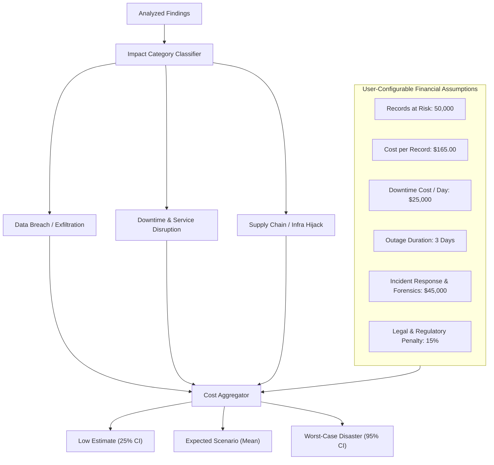

# 06. CyberShield — Risk Scoring & Worst-Case Disaster Cost Model

## 1. Transparent 0-100 Technical Risk Score Formula

The CyberShield **Overall Technical Risk Score ($R_{\text{total}}$)** is a deterministic composite value on a continuous scale from $0.0$ (clean/hardened) to $100.0$ (critical exposure).

### Mathematical Formula

$$R_{\text{total}} = \min\left(100, \; \sum_{i=1}^{N} \left[ S_i \times E_i \times A_i \times C_i \right] \times K_{\text{dampening}}\right)$$

Where for each finding $i$:
1. **Base Severity Weight ($S_i$)**:
   - `CRITICAL` = $25.0$
   - `HIGH` = $12.0$
   - `MEDIUM` = $4.0$
   - `LOW` = $1.0$
   - `INFO` = $0.1$
2. **Exploitability Multiplier ($E_i$)**:
   - In CISA Known Exploited Vulnerabilities (KEV): $1.5\times$
   - High EPSS ($\ge 0.50$): $1.3\times$
   - Medium EPSS ($0.10 \le \text{EPSS} < 0.50$): $1.1\times$
   - Standard / Unlisted: $1.0\times$
3. **Attack Surface & Exposure Multiplier ($A_i$)**:
   - Public Unauthenticated Endpoint / Route: $1.4\times$
   - Authenticated User Flow: $1.0\times$
   - Internal Worker / Admin Script: $0.7\times$
4. **Confidence Multiplier ($C_i$)**:
   - `CONFIRMED` / Multi-Tool Consensus: $1.0\times$
   - `HIGH`: $0.85\times$
   - `MEDIUM` / AI-Hypothesis: $0.60\times$
   - `LOW`: $0.30\times$
5. **Diminishing Marginal Return Dampening ($K_{\text{dampening}}$)**:
   - Prevents 50 low-priority alerts from artificially masking a single critical vulnerability:
   $$K_{\text{dampening}} = \frac{1}{\log_2(N + 2)}$$

---

### Worked Examples

#### Example A: Single Critical Pre-Auth RCE with High EPSS
- Findings: 1 Critical finding (unauthenticated route, EPSS = 0.72, Confirmed).
- Calculation: $S = 25.0$, $E = 1.3$, $A = 1.4$, $C = 1.0$.
- Finding Score: $25.0 \times 1.3 \times 1.4 \times 1.0 = 45.5$.
- Dampening: $N=1 \implies K = 1 / \log_2(3) = 1 / 1.585 \approx 0.631$.
- Weighted Score: $45.5 \times 0.631 \approx 28.7$.
- *Combined with base criticality floor rule (Single confirmed Critical on public route guarantees minimum score $\ge 65.0$)* $\implies$ **Final Risk Score = 72.0 (High Risk)**.

#### Example B: Clean Repository with Minor Linter Warnings
- Findings: 3 Low severity header warnings (Internal scripts, Confirmed).
- Calculation: $3 \times [1.0 \times 1.0 \times 0.7 \times 1.0] = 2.1$.
- Weighted Score $\implies$ **Final Risk Score = 1.5 (Low / Secure)**.

---

## 2. Worst-Case Disaster Cost & Impact Model

To bridge the gap between engineering and leadership, CyberShield models realistic financial disaster exposure.

### Transparent Mathematical Model

$$\text{Financial Disaster Exposure} = C_{\text{records}} + C_{\text{downtime}} + C_{\text{incident\_response}} + C_{\text{regulatory}}$$

1. **Record Loss Cost ($C_{\text{records}}$)**:
   $$C_{\text{records}} = \text{Records at Risk} \times \text{Cost per Record} \times P_{\text{breach}}$$
   *(Default $165/record based on IBM Security "Cost of a Data Breach Report 2024").*
2. **Downtime Cost ($C_{\text{downtime}}$)**:
   $$C_{\text{downtime}} = \text{Outage Days} \times \text{Downtime Cost per Day}$$
3. **Incident Response & Forensics ($C_{\text{incident\_response}}$)**:
   Fixed baseline forensics retainers and crisis communications (default: $35,000 – $75,000).
4. **Regulatory & Litigation Overhead ($C_{\text{regulatory}}$)**:
   $10\% - 25\%$ surcharge on direct breach costs under GDPR / CCPA enforcement benchmarks.

### Output Range Tiers
- **Low Impact (Best Case Containment)**: Immediate discovery, no external exfiltration confirmed. (Estimated at $0.35\times$ Expected).
- **Expected Impact (Likely Incident)**: Realistic average remediation, standard regulatory disclosure, 48-hour recovery.
- **Worst-Case Disaster (Catastrophic Breach)**: Full database dump published, extended multi-day downtime, maximum regulatory fines. (Estimated at $2.20\times$ Expected).

---

## 3. Attack Narrative Generation per Critical Finding

For every finding marked `CRITICAL` or `HIGH`, the engine compiles a realistic, step-by-step **Attack Narrative**:

> ### Example Narrative: Unauthenticated SQL Injection in Billing Webhook (`src/routes/webhook.ts:44`)
> 1. **Initial Vector**: Threat actor locates public webhook endpoint `/api/v1/stripe-callback` without signature validation.
> 2. **Exploitation**: Sends a crafted JSON payload containing a stacked SQL query in the `customer_id` parameter.
> 3. **Pivot & Exfiltration**: Query bypasses ORM parameterization, dumping the `users` and `payment_tokens` table to an attacker-controlled HTTP listener.
> 4. **Impact**: Compromise of 12,500 customer records, resulting in forced credential invalidation, mandatory regulatory notification under CCPA, and estimated incident response overhead of $185,000.

---

## 4. Mandatory Disclaimers & Source Traceability

> **LEGAL & FINANCIAL DISCLAIMER**:  
> *The risk scores and financial disaster estimates generated by CyberShield are mathematical models based on statistical industry averages (e.g., IBM Cost of a Data Breach Report 2024, Ponemon Institute research, CISA KEV catalog). They are intended solely for prioritization and educational benchmarking. They do not constitute financial forecasts, insurance underwriting guarantees, or legal compliance advice.*

- All default constants are version-tagged: `v2024.2 - Updated Oct 2024`.
- All variables can be modified directly by the user in the UI with instant recalculated output ranges.
