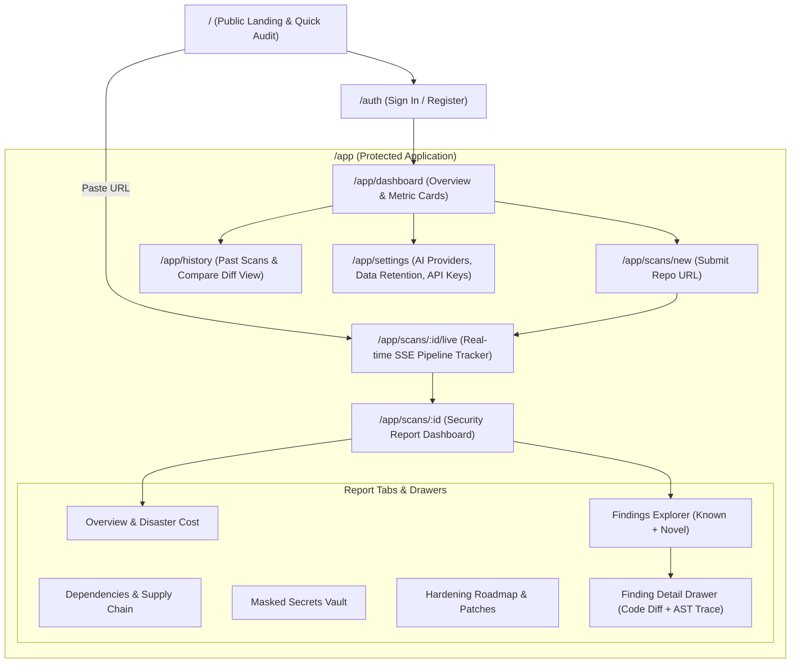

# 08. CyberShield — UX Architecture, Wireframes & Design System

## 1. Information Architecture & Sitemap



---

## 2. Low-Fidelity Wireframes

### A. Landing Page & Quick Scan Form
```
+--------------------------------------------------------------------------------------------------+
| [shield] CyberShield                   [Features]  [Docs]  [Live Demo]            [ Sign In ]   |
+--------------------------------------------------------------------------------------------------+
|                                                                                                  |
|              Discover Known CVEs & Novel Zero-Day Bugs in Public Repositories                     |
|                   Defensive code intelligence, AST taint tracking & financial risk models.        |
|                                                                                                  |
|      +-----------------------------------------------------------------------+  +------------+   |
|      | https://github.com/owner/repository                                   |  | Scan Repo  |   |
|      +-----------------------------------------------------------------------+  +------------+   |
|      (i) Public GitHub repositories up to 100MB. Zero code execution in production.             |
|                                                                                                  |
|   +--------------------------+  +--------------------------+  +--------------------------+       |
|   | ⚡ Dual Discovery Engines |  | 💰 Disaster Cost Model   |  | 🛡️ 1-Click Secure Patch  |       |
|   | SAST + Novel AST Taint   |  | Transparent $ calculations|  | Diffs + Unit Regression  |       |
|   +--------------------------+  +--------------------------+  +--------------------------+       |
+--------------------------------------------------------------------------------------------------+
```

### B. Live Scan Progress Tracker (`/app/scans/:id/live`)
```
+--------------------------------------------------------------------------------------------------+
| [shield] CyberShield  >  Scans  >  expressjs/express                                             |
+--------------------------------------------------------------------------------------------------+
| Scanning expressjs/express (commit: 7c49b01) ...                              [ Cancel Scan ]    |
|                                                                                                  |
| [=======================================>-----------------------] 65% Completed                  |
| Current Stage: Executing AST Taint & Call Graph Analysis...                                      |
|                                                                                                  |
| [✓] Stage 1: Validate & Fetch Repository Archive (2.4 MB)                           (0.8s)       |
| [✓] Stage 2: Secret Scanning (Gitleaks: 0 active tokens detected)                   (1.2s)       |
| [✓] Stage 3: SAST & Dependency SCA (Semgrep & OSV-Scanner: 14 findings)             (6.5s)       |
| [●] Stage 4: Novel Bug Discovery & Interprocedural Taint Tracing...                 (In progress)|
| [ ] Stage 5: AI Reasoning Verification & Remediation Patch Generation                (Pending)    |
| [ ] Stage 6: Technical Risk Scoring & Worst-Case Disaster Cost Formulation          (Pending)    |
|                                                                                                  |
| Console Telemetry Stream:                                                                        |
| > [12:04:15] Found 42 route entry points in src/router/index.js                                  |
| > [12:04:17] Tracing tainted param 'req.url' to filesystem sink at line 142                     |
+--------------------------------------------------------------------------------------------------+
```

### C. Report Dashboard & Findings Explorer (`/app/scans/:id`)
```
+--------------------------------------------------------------------------------------------------+
| expressjs/express  [Commit 7c49b01]  Scanned: 2 mins ago         [ Export PDF ] [ Export SARIF ] |
+--------------------------------------------------------------------------------------------------+
|  +------------------------+  +--------------------------------+  +-----------------------------+ |
|  | OVERALL RISK SCORE     |  | WORST-CASE DISASTER EXPOSURE   |  | FINDINGS SUMMARY            | |
|  |       [ 68 / 100 ]     |  |       $ 142,500                |  | 🔴 2 Critical   🟠 5 High    | |
|  | High Security Risk     |  | Range: $45k (Low) - $310k (Max)|  | 🟡 8 Medium     🔵 3 Low     | |
|  +------------------------+  +--------------------------------+  +-----------------------------+ |
|                                                                                                  |
|  [ Overview ]  [ *Findings (18)* ]  [ Dependencies (34) ]  [ Secrets (0) ]  [ Cost Model ]      |
|                                                                                                  |
|  Filters: [Severity: All v]  [Engine: All v]  [Confidence: All v]  [Search filename / rule...  ] |
|                                                                                                  |
|  Sev     | Finding Title                    | Engine          | Location           | Status      |
|  --------+----------------------------------+-----------------+--------------------+-------------|
|  🔴 CRIT | Path Traversal via Unsafe decode | Novel Discovery | src/view.js:78     | Confirmed   |
|  🟠 HIGH | Regex Denial of Service (ReDoS)  | Semgrep SAST    | lib/utils.js:214   | Verified    |
|  🟠 HIGH | Prototype Pollution in merge()   | Novel Discovery | lib/helpers.js:52  | Needs Review|
|  🟡 MED  | Missing Helmet Security Headers  | Trivy Config    | app.js:12          | Confirmed   |
+--------------------------------------------------------------------------------------------------+
```

### D. Finding Detail Drawer (Slide-Out)
```
+--------------------------------------------------------------------------------------------------+
| Finding Details: Path Traversal via Unsafe decode                                            [X] |
+--------------------------------------------------------------------------------------------------+
| Severity: CRITICAL | Confidence: CONFIRMED | Engine: Novel Discovery (AST Taint) | CWE-22        |
| File: src/view.js (Lines 76-85)                                                                  |
|                                                                                                  |
| Code Evidence:                                                                                   |
|  76 | function resolvePath(userFilename) {                                                       |
|  77 |   // Tainted user input passed directly without sanitization                               |
| >78 |   const fullPath = path.join(BASE_DIR, decodeURIComponent(userFilename));                  |
|  79 |   return fs.readFileSync(fullPath, 'utf8');                                                |
|  80 | }                                                                                          |
|                                                                                                  |
| Attack Narrative:                                                                                |
| An attacker sends a GET request with filename=%2e%2e%2f%2e%2e%2fetc%2fpasswd. decodeURIComponent |
| resolves the traversal before path validation, exposing host system configuration files.         |
|                                                                                                  |
| Remediation Diff:                                                                                |
| - const fullPath = path.join(BASE_DIR, decodeURIComponent(userFilename));                        |
| + const sanitized = path.normalize(decodeURIComponent(userFilename)).replace(/^(\.\.[\/\\])+/, '');|
| + const fullPath = path.resolve(BASE_DIR, sanitized);                                            |
| + if (!fullPath.startsWith(BASE_DIR)) throw new Error('Access denied: Path outside root');       |
|                                                                                                  |
| [ Copy Patch Diff ]    [ View Generated Unit Test ]    [ Mark False Positive ]                   |
+--------------------------------------------------------------------------------------------------+
```

---

## 3. Design System Tokens & Specifications (UI-UX Pro Max Aligned)

### Color Palette (Dark-First Theme)
- **Background Root**: Deep Midnight `#080C14`
- **Surface Level 1 (Cards, Navbars)**: Charcoal Obsidian `#0F172A`
- **Surface Level 2 (Drawers, Modals, Popovers)**: Slate Neutral `#1E293B`
- **Border Subtle**: `#334155`
- **Primary Brand Accent**: Electric Cyan `#06B6D4` / Indigo `#6366F1`
- **Typography Primary**: Crisp White `#F8FAFC` (Contrast ratio $> 14:1$)
- **Typography Secondary**: Muted Mongoose `#94A3B8` (Contrast ratio $> 5.5:1$)

### Accessible Severity Color Tokens (WCAG 2.1 AA Compliant)
*Never use color alone. Always pair with text badge, icon, and ARIA label.*
- **Critical**: Crimson `#EF4444` (Badge: Dark Crimson `#450A0A` with text `#FCA5A5`) + AlertTriangle Icon
- **High**: Vivid Orange `#F97316` (Badge: `#431407` with text `#FDBA74`) + AlertCircle Icon
- **Medium**: Amber Gold `#F59E0B` (Badge: `#451A03` with text `#FCD34D`) + InfoCircle Icon
- **Low**: Cobalt Blue `#3B82F6` (Badge: `#172554` with text `#93C5FD`) + ShieldCheck Icon
- **Info**: Slate `#64748B` (Badge: `#1E293B` with text `#CBD5E1`) + HelpCircle Icon

### Typography
- **Headings & Body UI**: `Inter`, `-apple-system`, `BlinkMacSystemFont`, `sans-serif`
- **Code Snippets & Terminal Traces**: `Fira Code`, `JetBrains Mono`, `Consolas`, `monospace`
- **Scale**:
  - `Display`: 32px / 1.2 / Bold
  - `H1`: 24px / 1.3 / SemiBold
  - `H2`: 20px / 1.4 / SemiBold
  - `Body`: 14px / 1.5 / Regular
  - `Caption / Monospace`: 12px / 1.4 / Regular

### Tone of Voice for Security Copy
- **Calm, Evidence-Backed, Engineering-Focused**: Avoid sensationalism or fear-mongering (e.g., use "Potential Unauthenticated Path Traversal Detected" instead of "DANGEROUS HACKER HOLE!").
- Clearly differentiate between deterministic confirmed scanner findings and probabilistic novel AI hypotheses.
