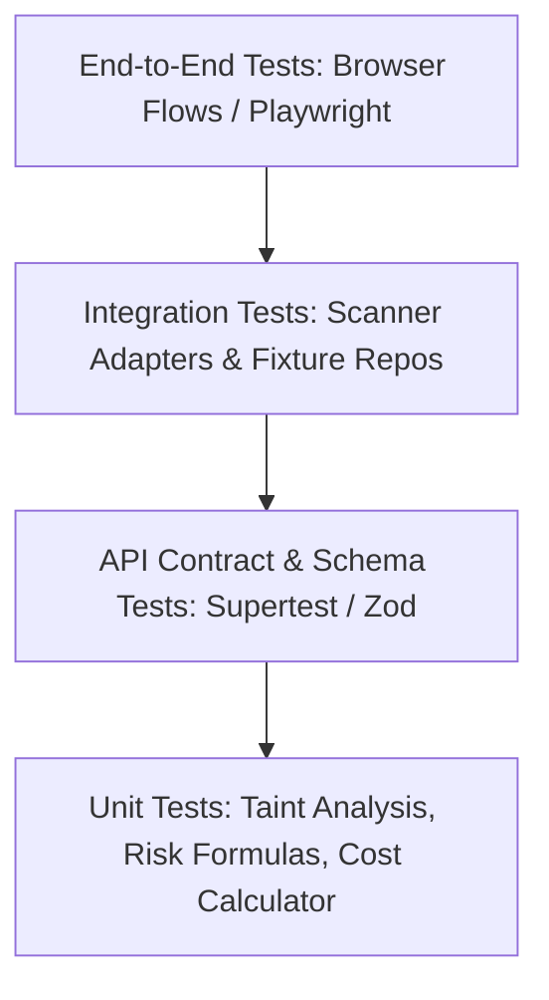

# 10. CyberShield — Test & Quality Assurance Plan

## 1. Test Pyramid & Automation Strategy

To guarantee high detection precision and absolute runtime safety, CyberShield employs a four-tiered testing hierarchy enforced on every pull request.

---

## 2. Testing Levels & Specifications

### Tier 1: Unit Testing (Jest / Vitest / Pytest)
- **Mathematical Models**: Tests risk score formula ($R_{\text{total}}$), dampening coefficients, and financial cost formulas against known boundary conditions ($N=0$, single critical, $N=500$ low severity).
- **Parsers & Normalizers**: Unit tests ensuring Gitleaks, Semgrep, and Trivy outputs correctly parse into the unified `CyberShieldFinding` schema.
- **Redaction Logic**: Unit test validating that regex secret detectors mask tokens before database persistence.

### Tier 2: Integration Testing & Deliberately Vulnerable Fixture Repo
A dedicated test repository fixture (`tests/fixtures/vulnerable-repo`) contains controlled, non-weaponized vulnerabilities across target risk classes:
1. **`auth/login.ts`**: Hardcoded JWT secret string (Gitleaks target).
2. **`api/users.ts`**: Unsanitized SQL concatenation (`"SELECT * FROM users WHERE id = '" + req.query.id + "'"` - Semgrep & AST Taint target).
3. **`files/download.ts`**: Path traversal via unnormalized `path.join(__dirname, req.params.path)` (Novel Bug AST Engine target).
4. **`package.json`**: Outdated dependency (`axios@0.21.1` with known SSRF CVE-2020-28168 - OSV-Scanner target).
5. **`clean/math.ts`**: Pure non-vulnerable helper functions (False-positive baseline check).

**Pass Criteria**:
- Detection engine MUST identify 100% of the 4 intentionally introduced vulnerabilities.
- False positive rate on `clean/math.ts` MUST be 0.
- All 4 findings must resolve to the correct line numbers and file paths.

### Tier 3: Security & Sandbox Isolation Tests
- **SSRF Suite**: Verifies rejection of private IP ranges (`10.0.0.0/8`, `172.16.0.0/12`, `192.168.0.0/16`, `127.0.0.1`, `169.254.169.254`, `localhost`, and internal Docker hostnames).
- **Tar Slip / Zip Bomb Suite**: Submits synthetic archives containing `../../escape` and high compression ratios; asserts immediate job abortion without host corruption.
- **Worker Egress Test**: Spawns an analyzer container and attempts `ping 8.8.8.8` and `curl https://google.com`; asserts connection failure (`EHOSTUNREACH` / `--network none`).

### Tier 4: End-to-End (E2E) Browser Tests (Playwright)
- User signs up, logs in, submits repository URL.
- Live scan page displays streaming progress stages via SSE.
- Completed scan loads dashboard cards, risk score gauge, findings table, and drawer view.
- User adjusts disaster cost sliders; validates instant recalculation of expected and worst-case totals.
- User clicks "Export PDF" and "Export SARIF"; verifies valid file downloads.

---

## 3. Scanner Precision & Recall Benchmarking

To prevent scanner degradation over time, CyberShield runs a continuous benchmark against the OWASP Benchmark and synthetic fixtures:
$$\text{Precision} = \frac{\text{True Positives}}{\text{True Positives} + \text{False Positives}} \ge 85\%$$
$$\text{Recall} = \frac{\text{True Positives}}{\text{True Positives} + \text{False Negatives}} \ge 90\%$$

---

## 4. Continuous Integration (CI) Quality Gates

GitHub Actions workflow enforces:
1. `pnpm lint` and `tsc --noEmit` (Zero linting and type errors).
2. `vitest run --coverage` (Minimum 80% code coverage on core risk engine, normalizers, and API controllers).
3. `pytest` on worker analysis packages.
4. Security check on CyberShield's own codebase (`pnpm audit` + Semgrep scan).
