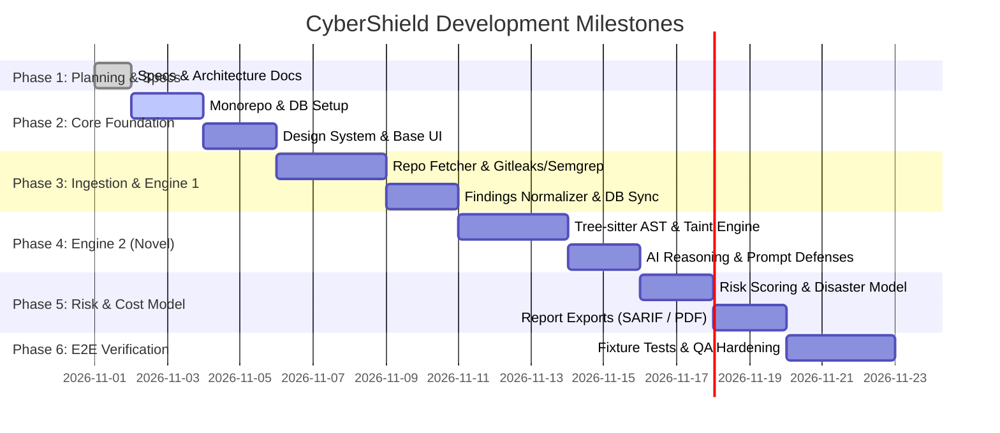

# 11. CyberShield — Phased Roadmap & Milestones

## 1. Phased Delivery Roadmap

---

## 2. Milestone Breakdown & Definition of Done (DoD)

### Milestone 1 (M1): Architecture & Design System (Phase 1 & 2)
- **Scope**: Complete `/docs` architecture specifications, initialize Turborepo, configure Prisma PostgreSQL schema, setup Redis, and create UI-UX Pro Max design tokens and shell layouts.
- **Effort**: 3-4 engineering days.
- **Definition of Done**:
  - All 13 planning docs completed and verified.
  - Turborepo builds without TypeScript errors.
  - Prisma migrations generate clean relational schema.
  - Base UI components (Cards, Badges, Tables, Score Gauges) rendered in dark theme.

### Milestone 2 (M2): Scan Ingestion & Known Vulnerability Engine (Phase 3)
- **Scope**: URL validator, safe repo archive downloader with zip-bomb safeguards, Gitleaks, Semgrep, and OSV-Scanner integration inside isolated container runtime.
- **Effort**: 5 engineering days.
- **Definition of Done**:
  - Submitting a public GitHub repo enqueues a BullMQ job.
  - Analyzers run in `--network none` container.
  - Normalized findings stored in Postgres and streamed to frontend via SSE.

### Milestone 3 (M3): Novel Bug Discovery Engine & AI Inspector (Phase 4)
- **Scope**: Tree-sitter AST parser, interprocedural taint flow tracker (sources $\to$ sinks), and structured AI hypothesis generation with schema validation and prompt injection defenses.
- **Effort**: 5 engineering days.
- **Definition of Done**:
  - Identifies logic bugs and taint flows not present in CVE databases.
  - Assigns `CYBER-NOVEL-xxxxx` tags with `Needs Verification` status.
  - Rejects prompt-injection strings inside repo code.

### Milestone 4 (M4): Risk Scoring, Disaster Costing & Hardening Roadmap (Phase 5)
- **Scope**: Mathematical 0-100 risk score calculation, interactive disaster financial cost estimator with sliders, automated patch diff generator, and SARIF/PDF export engines.
- **Effort**: 4 engineering days.
- **Definition of Done**:
  - Sliders dynamically adjust low, expected, and worst-case financial impact.
  - Critical findings display step-by-step attack narratives.
  - SARIF 2.1.0 and PDF exports download and validate successfully.

### Milestone 5 (M5): Quality, E2E Testing & Portfolio Release (Phase 6)
- **Scope**: Test against deliberately vulnerable fixture repo, achieve >85% precision, conduct STRIDE security verification, and document setup in README.
- **Effort**: 3 engineering days.
- **Definition of Done**:
  - Vulnerable fixture repo detection verifies 100% true positives.
  - Zero unhandled exceptions or broken buttons across all flows.
  - Complete Docker Compose local boot configuration verified.
